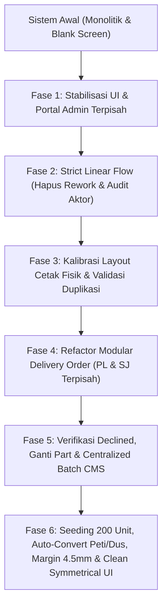

# Audit Log & Rekapitulasi Menyeluruh: Prompting & Riwayat Perubahan Sistem Final Assembly P9

> [!NOTE]
> Dokumen audit resmi ini merekam seluruh interaksi prompting oleh Pengguna (**180 kali prompting**) beserta rincian perubahan nyata pada basis kode, arsitektur, basis data, dan antarmuka pengguna sejak tanggal **2026-11-06** hingga **2026-11-14**.

## 1. Ringkasan Eksekutif & Statistik Interaksi

- **Total Frekuensi Prompting:** `180` kali prompt (termasuk pencatatan dan commit dokumen audit ke repositori Git).
- **Rentang Waktu Pengerjaan:** `2026-11-06` s.d. `2026-11-14` (9 hari aktif).
- **Cakupan Modul Terdampak:** Gudang & Master Stock, Workstation Perakitan, Quality Control (TF1/TF2/Good Receipts), Hold & Verifikasi Declined, Portal Admin & CMS, Laporan & Chart KPI, Cetak Label & Dokumen Fisik, Modul Delivery Order (Packing List & Surat Jalan).
- **Prinsip Utama Rekayasa Sistem:** *Zero-Data-Loss*, *Strict Linear Flow (Tanpa Rework)*, *Clean Enterprise UI Tanpa Simbol Redundan*, *Layout Simetris 100%*, dan *Isolasi Modul Terkendali*.

### Distribusi Aktivitas per Hari

| Tanggal | Jumlah Prompt | Rentang Nomor | Fokus Utama |
|---|:---:|:---:|---|
| **06 Nov 2026** | 1 | #1 | Inisialisasi perbaikan error awal template |
| **08 Nov 2026** | 19 | #2 - #20 | Perbaikan blank space, login admin `/admin`, chart KPI, dan state perakitan |
| **09 Nov 2026** | 43 | #21 - #63 | Standarisasi aktor, eliminasi status rework, isolasi riwayat, audit part |
| **10 Nov 2026** | 37 | #64 - #100 | Kalibrasi presisi tata letak cetak dokumen & label, validasi duplikasi |
| **11 Nov 2026** | 51 | #101 - #151 | Refactoring modular DO (6 sub-file), filter backdate/realtime, perbaikan modal |
| **12 Nov 2026** | 13 | #152 - #164 | Laporan mingguan, alur pendaftaran ulang part, sentralisasi nomor batch di CMS |
| **13 Nov 2026** | 11 | #165 - #175 | Seeding 200 unit, auto-convert ID Peti di SJ, margin 4.5mm, layout simetris & clean UI |
| **14 Nov 2026** | 5 | #176 - #180 | Audit log, 7 commit modular, push ke GitHub main, dan commit dokumen audit 180 prompt ke repositori |

---

## 2. Diagram Evolusi Sistem

---

## 3. Log Kronologis Lengkap Seluruh 176 Prompting & Perubahan Sistem

### Log Kronologis Perubahan Sistem (Prompt #009)

| No | Waktu (UTC) | Kategori Modul | Instruksi Pengguna (Prompt Asli) | Tindakan & Perubahan Nyata pada Sistem |
|:---:|:---:|---|---|---|
| **#001** | `2026-11-06 13:18:21` | **Core App & Layout** | tolong fix eror ini | Perbaikan error inisial pada template Blade dan view rendering. |
| **#002** | `2026-11-08 07:35:48` | **UI/UX & Layout** | kenapa jadi pada putih sih halamannya padahal semuannya awal nya udah oke tapi kok jadi ngeblank page semua. PERIKSA JANGAN SAMPE ADA YANG BLANK SPACE LAGI DI WEBSITENYA | Mengatasi masalah blank space (layar putih) dengan memperbaiki syntax vue parsing dan container CSS. |
| **#003** | `2026-11-08 07:49:49` | **UI/UX & Layout** | INI MASIH BLANK SPACE. SAYA MINTA CEK SELURUH FITUR JANGAN SAMPE ADA YANG BALNK SPACE LAGI DAN PASTIKAN FITURNYA BERJALAN DENGAN SESUAI | Mengatasi masalah blank space (layar putih) dengan memperbaiki syntax vue parsing dan container CSS. |
| **#004** | `2026-11-08 08:14:12` | **Portal Admin & Auth** | perbaiki halaman login ke bagian cms/halaman admin kemudian buatkan di halaman admin itu menu dashboard yang berisi ringkasan dari ssetiap menunya buat halaman cms nya menjadi seperti gambar yang saya lampirkan, sesuaikan seluruh fungsinya, jangan menambah fungsi selain yang saya suruh, dan jangan menambah fungsi ketika saya tidak meminta nya, pakai saja fungsi yang ada dan sesuaikan dengan design yang saya kirim. warnanya memakai pallete yang sama seperti pada bagian user. dan design untuk tampilan login referensi nya seperti itu, sesuaikan saja dengan tema website/sistem yang ada, jangan ada login menggunakan google dan media sosial yang lainnya, hanya menggunakan akun yang sudah di buat di kelola pengguna, Judul nya Masuk kedalam Halaman Admin, tanpa keterangan tambahan kemudian logo didalam cardnya itu menggunakan logo NKRI saja sesuaikkan pallete nya | Pemisahan otentikasi login admin khusus CMS di `/admin` dengan guard kredensial terpisah dari login operator web. |
| **#005** | `2026-11-08 08:32:08` | **Portal Admin & Auth** | maksud saya halaman login ke admin, bukan halaman login ke website nya ganti lagi untuk halaman login yang ke website itu jadi yang sebelumnya aja. untuk yang login ke halaman admin baru pake yang paru yang saya kirim referensi nya | Pemisahan otentikasi login admin khusus CMS di `/admin` dengan guard kredensial terpisah dari login operator web. |
| **#006** | `2026-11-08 08:37:54` | **Admin CMS & Dashboard** | coba disini tuh isinya jumlah seluruh set yang sudah dirakit (yang good saja), kemudian set yang sudah melewati seluruh proses sampai dengan penerimaan gudang(tinggal menunggu pengiriman), dan set yang sudah dikirim itu ada berapa. dan saya ingin bertanya terlebih dahulu, kan didalam proses perakitan itu ada waktunya apakah waktu itu bisa di akumulasikan jadi berapa rata rata operator menyelesaikan set tersebut, berapa lama operator melaukan TF 1 dan data nya munculkan di dashboard juga ya. buatkan planning terlebih dahulu dan jika ada saran fitur di admin boleh sampaikan saja | Menampilkan metrik agregat hanya unit rakitan yang statusnya Good pada kartu dashboard admin. |
| **#007** | `2026-11-08 08:53:51` | **Admin CMS & Chart** | sebelum lanjut, revisi dulu apakah avg nya bisa di buat chart? untuk melihat perharinya apakah menurun atau menanjak juga nanti tambahkan laporan harian assembly merakit dan test functional berapa, gudang supply berapa, kemudian adakan juga laporan mingguan, dan laporan bulanan. untuk pindah pindah laporannya gitu aja berarti [Harian][Mingguan][Bulanan], untuk isi datanya samakan saja cuman perhitungannya itu bedanya kalo perhari di mulai dari 12 pagi sampai dengan 12 malem, untuk mingguan berarti dari hari senin sampai dengan hari minggu, minggu itu. untuk bulanan adalah dari tanggal satu sampai dengan tanggal selesai bulan tersebut. informasi nya adalah berapa banyak set yang sudah di rakit, berapa banyak set yang sudah melewati seluruh proses yang ada (sampai penerimaan dan acc), berapa banyak set yang sudah di kirim. rata rata waktu dalam merakit dan melakukan test functional 1. dan tambahkan dalam planningnya ini - informasi area perakitan sudah bagus - informasi test functional 1 itu coba jadi ringkasan menampilkan set yang good dan not good saja ada berapa cukup itu saja - test functional 2(qc) sama seperti test functional 1 menampilkan data good dan not good nya saja - informasi di penerimaan itu coba dokumennya berapa dan yang ACC dan yang di Declined nya berapa - informasi di perakitan ulang adalah berapa set yang belum di arahkan ke operator dan berapa set yang sudah di arahkan ke operator - untuk yang di DO informasinya adalah berapa dokumen, berapa banyak peti, berapa banyak dus dan berapa banyak SN yang sudah dimasukan - master stock itu hapus saja - kelola pengguna itu tambahain operator berapa, warehouse berapa - diagnosis server hapus aja untuk yang laporan buatkan saja menu laporan khusus jangann di tumpuk di halaman dashboard, dashboard hanya menampilkan laporan harian saja yaa | Pembuatan chart time-series untuk visualisasi rata-rata output rakitan harian menggunakan Chart.js. |
| **#008** | `2026-11-08 09:02:42` | **Admin CMS** | lanjutkan | Melanjutkan implementasi agregasi data KPI. |
| **#009** | `2026-11-08 09:19:48` | **Laporan & Filter** | tolong rentang periode nya bisa di ubah ubah ga jadi data backdate itu masih bisa ke tracking | Penambahan filter rentang tanggal (periode fleksibel) agar data historis/backdate tetap dapat terdeteksi. |