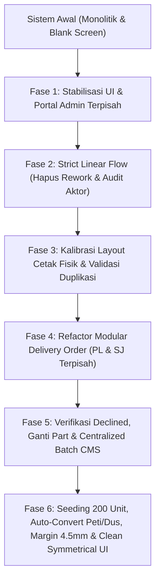

# Audit Log & Rekapitulasi Menyeluruh: Prompting & Riwayat Perubahan Sistem Final Assembly P9

> [!NOTE]
> Dokumen audit resmi ini merekam seluruh interaksi prompting oleh Pengguna (**180 kali prompting**) beserta rincian perubahan nyata pada basis kode, arsitektur, basis data, dan antarmuka pengguna sejak tanggal **2026-11-06** hingga **2026-11-14**.

## 1. Ringkasan Eksekutif & Statistik Interaksi

- **Total Frekuensi Prompting:** `180` kali prompt (termasuk pencatatan dan commit dokumen audit ke repositori Git).
- **Rentang Waktu Pengerjaan:** `2026-11-06` s.d. `2026-11-14` (9 hari aktif).
- **Cakupan Modul Terdampak:** Gudang & Master Stock, Workstation Perakitan, Quality Control (TF1/TF2/Good Receipts), Hold & Verifikasi Declined, Portal Admin & CMS, Laporan & Chart KPI, Cetak Label & Dokumen Fisik, Modul Delivery Order (Packing List & Surat Jalan).
- **Prinsip Utama Rekayasa Sistem:** *Zero-Data-Loss*, *Strict Linear Flow (Tanpa Rework)*, *Clean Enterprise UI Tanpa Simbol Redundan*, *Layout Simetris 100%*, dan *Isolasi Modul Terkendali*.

### Distribusi Aktivitas per Hari

| Tanggal | Jumlah Prompt | Rentang Nomor | Fokus Utama |
|---|:---:|:---:|---|
| **06 Nov 2026** | 1 | #1 | Inisialisasi perbaikan error awal template |
| **08 Nov 2026** | 19 | #2 - #20 | Perbaikan blank space, login admin `/admin`, chart KPI, dan state perakitan |
| **09 Nov 2026** | 43 | #21 - #63 | Standarisasi aktor, eliminasi status rework, isolasi riwayat, audit part |
| **10 Nov 2026** | 37 | #64 - #100 | Kalibrasi presisi tata letak cetak dokumen & label, validasi duplikasi |
| **11 Nov 2026** | 51 | #101 - #151 | Refactoring modular DO (6 sub-file), filter backdate/realtime, perbaikan modal |
| **12 Nov 2026** | 13 | #152 - #164 | Laporan mingguan, alur pendaftaran ulang part, sentralisasi nomor batch di CMS |
| **13 Nov 2026** | 11 | #165 - #175 | Seeding 200 unit, auto-convert ID Peti di SJ, margin 4.5mm, layout simetris & clean UI |
| **14 Nov 2026** | 5 | #176 - #180 | Audit log, 7 commit modular, push ke GitHub main, dan commit dokumen audit 180 prompt ke repositori |

---

## 2. Diagram Evolusi Sistem

---

## 3. Log Kronologis Lengkap Seluruh 176 Prompting & Perubahan Sistem

### Log Kronologis Perubahan Sistem (Prompt #003)

| No | Waktu (UTC) | Kategori Modul | Instruksi Pengguna (Prompt Asli) | Tindakan & Perubahan Nyata pada Sistem |
|:---:|:---:|---|---|---|
| **#001** | `2026-11-06 13:18:21` | **Core App & Layout** | tolong fix eror ini | Perbaikan error inisial pada template Blade dan view rendering. |
| **#002** | `2026-11-08 07:35:48` | **UI/UX & Layout** | kenapa jadi pada putih sih halamannya padahal semuannya awal nya udah oke tapi kok jadi ngeblank page semua. PERIKSA JANGAN SAMPE ADA YANG BLANK SPACE LAGI DI WEBSITENYA | Mengatasi masalah blank space (layar putih) dengan memperbaiki syntax vue parsing dan container CSS. |
| **#003** | `2026-11-08 07:49:49` | **UI/UX & Layout** | INI MASIH BLANK SPACE. SAYA MINTA CEK SELURUH FITUR JANGAN SAMPE ADA YANG BALNK SPACE LAGI DAN PASTIKAN FITURNYA BERJALAN DENGAN SESUAI | Mengatasi masalah blank space (layar putih) dengan memperbaiki syntax vue parsing dan container CSS. |