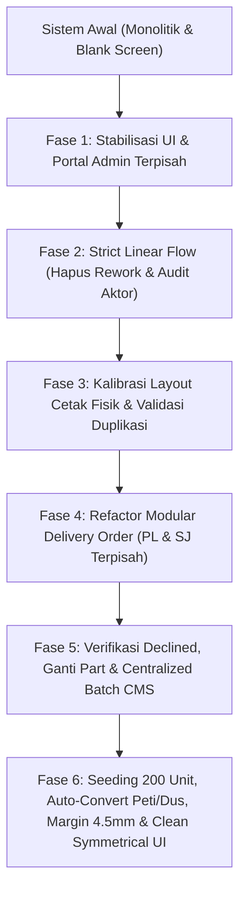

# Audit Log & Rekapitulasi Menyeluruh: Prompting & Riwayat Perubahan Sistem Final Assembly P9

> [!NOTE]
> Dokumen audit resmi ini merekam seluruh interaksi prompting oleh Pengguna (**180 kali prompting**) beserta rincian perubahan nyata pada basis kode, arsitektur, basis data, dan antarmuka pengguna sejak tanggal **2026-11-06** hingga **2026-11-14**.

## 1. Ringkasan Eksekutif & Statistik Interaksi

- **Total Frekuensi Prompting:** `180` kali prompt (termasuk pencatatan dan commit dokumen audit ke repositori Git).
- **Rentang Waktu Pengerjaan:** `2026-11-06` s.d. `2026-11-14` (9 hari aktif).
- **Cakupan Modul Terdampak:** Gudang & Master Stock, Workstation Perakitan, Quality Control (TF1/TF2/Good Receipts), Hold & Verifikasi Declined, Portal Admin & CMS, Laporan & Chart KPI, Cetak Label & Dokumen Fisik, Modul Delivery Order (Packing List & Surat Jalan).
- **Prinsip Utama Rekayasa Sistem:** *Zero-Data-Loss*, *Strict Linear Flow (Tanpa Rework)*, *Clean Enterprise UI Tanpa Simbol Redundan*, *Layout Simetris 100%*, dan *Isolasi Modul Terkendali*.

### Distribusi Aktivitas per Hari

| Tanggal | Jumlah Prompt | Rentang Nomor | Fokus Utama |
|---|:---:|:---:|---|
| **06 Nov 2026** | 1 | #1 | Inisialisasi perbaikan error awal template |
| **08 Nov 2026** | 19 | #2 - #20 | Perbaikan blank space, login admin `/admin`, chart KPI, dan state perakitan |
| **09 Nov 2026** | 43 | #21 - #63 | Standarisasi aktor, eliminasi status rework, isolasi riwayat, audit part |
| **10 Nov 2026** | 37 | #64 - #100 | Kalibrasi presisi tata letak cetak dokumen & label, validasi duplikasi |
| **11 Nov 2026** | 51 | #101 - #151 | Refactoring modular DO (6 sub-file), filter backdate/realtime, perbaikan modal |
| **12 Nov 2026** | 13 | #152 - #164 | Laporan mingguan, alur pendaftaran ulang part, sentralisasi nomor batch di CMS |
| **13 Nov 2026** | 11 | #165 - #175 | Seeding 200 unit, auto-convert ID Peti di SJ, margin 4.5mm, layout simetris & clean UI |
| **14 Nov 2026** | 5 | #176 - #180 | Audit log, 7 commit modular, push ke GitHub main, dan commit dokumen audit 180 prompt ke repositori |

---

## 2. Diagram Evolusi Sistem

---

## 3. Log Kronologis Lengkap Seluruh 176 Prompting & Perubahan Sistem

### Log Kronologis Perubahan Sistem (Prompt #072)

| No | Waktu (UTC) | Kategori Modul | Instruksi Pengguna (Prompt Asli) | Tindakan & Perubahan Nyata pada Sistem |
|:---:|:---:|---|---|---|
| **#001** | `2026-11-06 13:18:21` | **Core App & Layout** | tolong fix eror ini | Perbaikan error inisial pada template Blade dan view rendering. |
| **#002** | `2026-11-08 07:35:48` | **UI/UX & Layout** | kenapa jadi pada putih sih halamannya padahal semuannya awal nya udah oke tapi kok jadi ngeblank page semua. PERIKSA JANGAN SAMPE ADA YANG BLANK SPACE LAGI DI WEBSITENYA | Mengatasi masalah blank space (layar putih) dengan memperbaiki syntax vue parsing dan container CSS. |
| **#003** | `2026-11-08 07:49:49` | **UI/UX & Layout** | INI MASIH BLANK SPACE. SAYA MINTA CEK SELURUH FITUR JANGAN SAMPE ADA YANG BALNK SPACE LAGI DAN PASTIKAN FITURNYA BERJALAN DENGAN SESUAI | Mengatasi masalah blank space (layar putih) dengan memperbaiki syntax vue parsing dan container CSS. |
| **#004** | `2026-11-08 08:14:12` | **Portal Admin & Auth** | perbaiki halaman login ke bagian cms/halaman admin kemudian buatkan di halaman admin itu menu dashboard yang berisi ringkasan dari ssetiap menunya buat halaman cms nya menjadi seperti gambar yang saya lampirkan, sesuaikan seluruh fungsinya, jangan menambah fungsi selain yang saya suruh, dan jangan menambah fungsi ketika saya tidak meminta nya, pakai saja fungsi yang ada dan sesuaikan dengan design yang saya kirim. warnanya memakai pallete yang sama seperti pada bagian user. dan design untuk tampilan login referensi nya seperti itu, sesuaikan saja dengan tema website/sistem yang ada, jangan ada login menggunakan google dan media sosial yang lainnya, hanya menggunakan akun yang sudah di buat di kelola pengguna, Judul nya Masuk kedalam Halaman Admin, tanpa keterangan tambahan kemudian logo didalam cardnya itu menggunakan logo NKRI saja sesuaikkan pallete nya | Pemisahan otentikasi login admin khusus CMS di `/admin` dengan guard kredensial terpisah dari login operator web. |
| **#005** | `2026-11-08 08:32:08` | **Portal Admin & Auth** | maksud saya halaman login ke admin, bukan halaman login ke website nya ganti lagi untuk halaman login yang ke website itu jadi yang sebelumnya aja. untuk yang login ke halaman admin baru pake yang paru yang saya kirim referensi nya | Pemisahan otentikasi login admin khusus CMS di `/admin` dengan guard kredensial terpisah dari login operator web. |
| **#006** | `2026-11-08 08:37:54` | **Admin CMS & Dashboard** | coba disini tuh isinya jumlah seluruh set yang sudah dirakit (yang good saja), kemudian set yang sudah melewati seluruh proses sampai dengan penerimaan gudang(tinggal menunggu pengiriman), dan set yang sudah dikirim itu ada berapa. dan saya ingin bertanya terlebih dahulu, kan didalam proses perakitan itu ada waktunya apakah waktu itu bisa di akumulasikan jadi berapa rata rata operator menyelesaikan set tersebut, berapa lama operator melaukan TF 1 dan data nya munculkan di dashboard juga ya. buatkan planning terlebih dahulu dan jika ada saran fitur di admin boleh sampaikan saja | Menampilkan metrik agregat hanya unit rakitan yang statusnya Good pada kartu dashboard admin. |
| **#007** | `2026-11-08 08:53:51` | **Admin CMS & Chart** | sebelum lanjut, revisi dulu apakah avg nya bisa di buat chart? untuk melihat perharinya apakah menurun atau menanjak juga nanti tambahkan laporan harian assembly merakit dan test functional berapa, gudang supply berapa, kemudian adakan juga laporan mingguan, dan laporan bulanan. untuk pindah pindah laporannya gitu aja berarti [Harian][Mingguan][Bulanan], untuk isi datanya samakan saja cuman perhitungannya itu bedanya kalo perhari di mulai dari 12 pagi sampai dengan 12 malem, untuk mingguan berarti dari hari senin sampai dengan hari minggu, minggu itu. untuk bulanan adalah dari tanggal satu sampai dengan tanggal selesai bulan tersebut. informasi nya adalah berapa banyak set yang sudah di rakit, berapa banyak set yang sudah melewati seluruh proses yang ada (sampai penerimaan dan acc), berapa banyak set yang sudah di kirim. rata rata waktu dalam merakit dan melakukan test functional 1. dan tambahkan dalam planningnya ini - informasi area perakitan sudah bagus - informasi test functional 1 itu coba jadi ringkasan menampilkan set yang good dan not good saja ada berapa cukup itu saja - test functional 2(qc) sama seperti test functional 1 menampilkan data good dan not good nya saja - informasi di penerimaan itu coba dokumennya berapa dan yang ACC dan yang di Declined nya berapa - informasi di perakitan ulang adalah berapa set yang belum di arahkan ke operator dan berapa set yang sudah di arahkan ke operator - untuk yang di DO informasinya adalah berapa dokumen, berapa banyak peti, berapa banyak dus dan berapa banyak SN yang sudah dimasukan - master stock itu hapus saja - kelola pengguna itu tambahain operator berapa, warehouse berapa - diagnosis server hapus aja untuk yang laporan buatkan saja menu laporan khusus jangann di tumpuk di halaman dashboard, dashboard hanya menampilkan laporan harian saja yaa | Pembuatan chart time-series untuk visualisasi rata-rata output rakitan harian menggunakan Chart.js. |
| **#008** | `2026-11-08 09:02:42` | **Admin CMS** | lanjutkan | Melanjutkan implementasi agregasi data KPI. |
| **#009** | `2026-11-08 09:19:48` | **Laporan & Filter** | tolong rentang periode nya bisa di ubah ubah ga jadi data backdate itu masih bisa ke tracking | Penambahan filter rentang tanggal (periode fleksibel) agar data historis/backdate tetap dapat terdeteksi. |
| **#010** | `2026-11-08 09:38:28` | **Admin CMS** | ini bocor harusnya hari ini doang gausah ada opsi itu | Membatasi tampilan dashboard hanya pada transaksi hari ini dan menghapus label 'optimal rata-rata'. |
| **#011** | `2026-11-08 09:38:47` | **Admin CMS** | ini bocor harusnya hari ini doang gausah ada opsi itu juga hapus itu label optimal rata rata normal nya kan udah ada status performa dibawah | Membatasi tampilan dashboard hanya pada transaksi hari ini dan menghapus label 'optimal rata-rata'. |
| **#012** | `2026-11-08 18:18:44` | **Workstation Assembly** | saya belum ngerait kpk data ininya sudah ada? harusnya mulai dari 0 ga sih? soalnya memang sebelum nya ada beberapa yang sudah dirakit namun saya reset data tray dan rakitan harusnya itu ikut ke reset gasih? | Inisialisasi count mulai dari 0 jika belum ada aktivitas perakitan pada hari berjalan. |
| **#013** | `2026-11-08 21:34:07` | **Warehouse & Supply** | ketika status nya diubah jadi supplied tidak muncul datanya apakah ada yang eror? kalo status nya semua status datanya muncul ketika statusnya ini diubah ke good atau tersedia dan lain lain intinya ketika filtering by status di aktifkan itu tidak muncul datanya | Memperbaiki reaktivitas Vue ketika status part diubah menjadi 'supplied' agar data langsung muncul. |
| **#014** | `2026-11-08 21:56:47` | **Assembly & Ganti Part** | hapus pilihan part dignati di drop downnya | Menghapus opsi pemilihan part yang diganti dari dropdown. |
| **#015** | `2026-11-08 21:59:15` | **Assembly State** | ini masih nyangkutt | Pembersihan state reaktif agar data form tidak menyangkut saat berganti tray/set. |
| **#016** | `2026-11-08 22:08:12` | **Workstation Assembly** | ketika set 1 nya itu diganti part 1 nya yang asalnya 013 menjadi 019 itu set 10 nya kok hilang | Memperbaiki bug penggantian part di mana pergantian pada set 1 tidak lagi menghilangkan set 10. |
| **#017** | `2026-11-08 22:23:19` | **Warehouse & Returns** | ketika pengembalian digudang kemudian di declined maka setnya tidak hilang tetep ada di dalam situ untuk historynya | Memastikan data set tidak hilang saat pengembalian barang ke gudang dideclined. |
| **#018** | `2026-11-08 22:38:42` | **Hold & Declined** | status partnya jadi declined bukan tersedia kan harus di verif admin dulu | Mengubah status part yang ditolak menjadi 'declined' (wajib verifikasi admin) bukan langsung 'tersedia'. |
| **#019** | `2026-11-08 22:47:50` | **Workstation Assembly** | ini format dokumen yang selesaikan sesi dan dilanjutkan ke orang selanjutnya kok udah berubah? kan harussnya ada - S2 nya | Menstandarisasi format dokumen serah terima sesi kerja antar operator. |
| **#020** | `2026-11-08 23:55:14` | **Workstation Assembly** | ini masih gada s2nya terus itu didalamnya satu set kok tertulisnya malah 2? | Memperbaiki penomoran set dan penandaan sesi S2 agar konsisten 1 set = 3 part. |
| **#021** | `2026-11-09 00:37:49` | **Warehouse & Returns** | ini statusnya kok masih tersupply padahal sudah dikembalikan ke gudang kan? harus nya historynya tertulis selesai kemudian ketika dilihat detail barang yanng dikembalikan ke gudang bertuliskan dikembalikan ke gudang gitu | Memperbaiki riwayat status agar part yang dikembalikan ke gudang tidak lagi berstatus tersupply. |
| **#022** | `2026-11-09 01:03:24` | **Riwayat & History** | ini juga history di tf 1 ketika di click detail dan dilihat persetnya kok hasilnya gada tf 1nnya? malah yang di perakitan ada tf 1 nya kok aneh | Mengisolasi detail riwayat perakitan, TF1, dan TF2 agar hanya menampilkan hasil proses pada tahap tersebut. |
| **#023** | `2026-11-09 01:12:53` | **Riwayat & History** | ini juga di detail perakitan harusnya munculin hasil perakitannya saja | Mengisolasi detail riwayat perakitan, TF1, dan TF2 agar hanya menampilkan hasil proses pada tahap tersebut. |
| **#024** | `2026-11-09 01:24:19` | **Riwayat & History** | lakukan ini juga pada history yang lain perakitan berarti menampilkan hasil perakitan, TF 1 berarti menampilkan hasil perakitan dan TF 1, TF 2 berarti menampilkan hasil perakitan, TF 1 dan TF 2, kemudian penerimaan berarti menampilkan hasil perakitan, TF 1, TF 2 dan Penerimaan, dengan syarat syarat yang sudah di tetapkan jika belum dilakukan berarti statusnya pending pada proses tersebut. dan syarat syarat yang sudah diterapkan apakah masih igat? coba jelaskan | Mengisolasi detail riwayat perakitan, TF1, dan TF2 agar hanya menampilkan hasil proses pada tahap tersebut. |
| **#025** | `2026-11-09 01:28:51` | **Audit Log & Auth** | itu kenapa jadi gitu aktornya? aktornya sesuain aja sama akun yang ngelakuin action tersebut | Standarisasi pencatatan aktor (user pelaku) menggunakan nama lengkap dari akun yang sedang login. |
| **#026** | `2026-11-09 01:33:29` | **Quality Control (TF2)** | sata TF 2 tidak masuk kedalam historynya kemudian itu ilangin saja, hanya diakses lewat tulis manual di link nya dengan /admin jadi rahasia | Menghapus menu TF2 mandiri dan mengintegrasikan akses langsung melalui alur kelolosan sistem. |
| **#027** | `2026-11-09 01:40:15` | **Quality Control & GR** | ini bisa ga tulisannya ubah jadi lanjut ke Good Receipts dan verifikasi tiap partnya hilangin saja ketika verifikasi TF 1 dan 2 tidak di perlukan soalnya | Mengubah label flow menjadi 'Lanjut ke Good Receipts' serta meniadakan verifikasi part individual yang tidak perlu. |
| **#028** | `2026-11-09 01:43:30` | **Quality Control & GR** | ini bisa ga tulisannya ubah jadi lanjut ke Good Receipts dan verifikasi tiap partnya hilangin saja ketika verifikasi TF 1 dan 2 tidak di perlukan soalnya | Mengubah label flow menjadi 'Lanjut ke Good Receipts' serta meniadakan verifikasi part individual yang tidak perlu. |
| **#029** | `2026-11-09 01:45:53` | **Audit Log & Auth** | standarisasi untuk data actor atau data yang melakukan itu menggunakan nama dari akun yang digunakan, jangan menggunakan operator saja atau gudang saja, tulis saja nama aktual dari akun tersebut. untuk keseluruhan sistem ya dikarenakan itu untuk mengetahui siapa saja yang melakukan action ini, siapa saja yang melakukan perubahan ini jadi gampang untuk diketahuinya terus untuk foto yang saya lampirkan itu kenapa masih ada status rework. saya sudah bilang hapus saja status rework dan keseluruhan status rework | Standarisasi pencatatan aktor (user pelaku) menggunakan nama lengkap dari akun yang sedang login. |
| **#030** | `2026-11-09 01:51:29` | **Quality Control (TF1)** | ini eror baru saja di verif untuk lanjut ke TF 1 dari perakitan kok sudah 94% seharusnya belum ada test yang dijalan kan ga sih? | Memperbaiki kalkulasi persentase kelolosan pada TF1 yang melonjak sebelum proses pengujian. |
| **#031** | `2026-11-09 02:22:22` | **Workstation Assembly** | ini kok dirakit ulang padahal kan di history yang perakitan dia good inget untuk history itu tidak bisa dirubah dan hanya hasil dari proses yang dilakukannya saja kalo good yasudah good tidak bisa diubah | Mencegah perakitan ulang pada set yang sudah Good di riwayat perakitan. |
| **#032** | `2026-11-09 02:36:05` | **UI/UX & Modals** | hapus saja button dan fungsi ini di history | Menghapus tombol aksi yang tidak diperlukan pada modal riwayat. |
| **#033** | `2026-11-09 02:40:25` | **UI/UX Standarisasi** | standarisasi untuk status bentukannya itu seperti gambar kedua yang saya lampirkan saja. begitupun untuk history penerimaan dan TF 2. jika history yang TF2 itu TF1nya lolos maka tulis saja good jangan ada tambahan kata lolos diatasnya, kemudian untuk yang penerimaan itu tulis saja accepted dengan warna hijau fontnya dan declined dengan font merah fontnya ya | Standarisasi badge status seragam sesuai referensi visual badge modern. |
| **#034** | `2026-11-09 03:00:19` | **Portal Admin** | INI BAGIAN ADMIN KEMANAA | Mengembalikan navigasi dan tab admin yang sempat tersembunyi. |
| **#035** | `2026-11-09 03:07:11` | **Quality Control & Verifikasi** | ini kok sudah selesai saya belum verifikasi loh | Memperbaiki bug auto-complete kelolosan; unit wajib menunggu verifikasi manual operator/admin. |
| **#036** | `2026-11-09 03:12:56` | **Admin & Verifikasi** | ini untuk apa? | Menghapus opsi verifikasi duplikat yang fungsinya redundan dengan tombol verifikasi utama. |
| **#037** | `2026-11-09 03:13:42` | **Admin & Verifikasi** | apa bedanya sama verifikasi biasa? | Menghapus opsi verifikasi duplikat yang fungsinya redundan dengan tombol verifikasi utama. |
| **#038** | `2026-11-09 03:14:40` | **Admin & Verifikasi** | hapus aja sama aja itu fungsinya | Menghapus opsi verifikasi duplikat yang fungsinya redundan dengan tombol verifikasi utama. |
| **#039** | `2026-11-09 03:15:07` | **Admin & Verifikasi** | hapus aja sama aja itu fungsinya sama yang saya lampirkan | Menghapus opsi verifikasi duplikat yang fungsinya redundan dengan tombol verifikasi utama. |
| **#040** | `2026-11-09 03:18:44` | **Admin & Layout** | eror foto kedua yang saya lampirkan itu kurang rapih layoutnya rapihkan | Memperbaiki error dan merapikan layout tabel verifikasi agar proporsional. |
| **#041** | `2026-11-09 03:24:19` | **Admin & Layout** | eror foto kedua yang saya lampirkan itu kurang rapih layoutnya rapihkan | Memperbaiki error dan merapikan layout tabel verifikasi agar proporsional. |
| **#042** | `2026-11-09 03:32:50` | **Workstation Assembly** | ini sudah semua harusnya itu setnya di lock gabisa di pencet lagi button nya | Mengunci tombol aksi pada set yang seluruh prosesnya telah selesai. |
| **#043** | `2026-11-09 03:40:11` | **System Generator** | bukannya ini auto generate ya? kok bisa di isi sendiri? buat menjadi auto generate aja. tulisan auto counter/bisa editnya hapus aja kemudian untuk data bulk itu coba buat validasi jika SN yang dimasukan itu tidak sesuai dengan SN yang tersedia maka munculkan notif SN tidak tersedia. Dan data SN yang bisa dimasukan adalah SN yang sudah melewati seluruh proses dan sudah melewati penerimaan, tinggal nunggu di input. kemudian untuk drop down dimenu PL dan DO itu tolong perbaiki jelek banget buat lebih elegant dan proffesional dan user friendly | Mengubah penomoran dokumen menjadi auto-generate otomatis oleh sistem. |
| **#044** | `2026-11-09 03:44:32` | **Workstation Assembly** | kok dua padahal kan ini 1 sudah selesai berarti tinggal 1 ga sih? | Memperbaiki perhitungan sisa set yang belum diproses. |
| **#045** | `2026-11-09 04:07:39` | **Delivery Order & Validasi** | @[Quote] intinya SN yang bisa di masukan kedalam pengiriman adalah SN yang sudah melewati semua proses yang ada dalam sistem meskipun ada beberapa hambatan misal di perakitan dia di hold tapi sudah meewati verifikasi admin dan lanjut ke tahap selanjut hingga dipenerimaan dia di acc itu juga bisa, jadi intinya semua SN yang sudah melewati proses dengan kondisi good(baik langsung good maupun good setelah melewati beberapa proses dulu itu sama saja) | Validasi ketat: Hanya Serial Number yang sudah lolos QC/Good Receipts yang dapat dimasukkan ke pengiriman. |
| **#046** | `2026-11-09 04:15:04` | **Quality Control (Anti-Rework)** | INGAT TIDAK ADA STATUS REWORK | Menghapus seluruh status dan tombol 'Rework' dari seluruh modul sistem (strict linear flow). |
| **#047** | `2026-11-09 04:17:08` | **Quality Control & Verifikasi** | ini saya belum memverifikasi tetapi kok sudah selesai masyallah tolong perbaiki jangan sampe saya prompting lagi prompting lagi cuman gara gara masalah ini | Memperbaiki bug auto-complete kelolosan; unit wajib menunggu verifikasi manual operator/admin. |
| **#048** | `2026-11-09 04:58:03` | **UI/UX Components** | nih drop downnya jelek mana gada | Mendesain ulang dropdown custom dengan style clean modern. |
| **#049** | `2026-11-09 05:08:17` | **Print Layout** | tanggal label nya tidak simetris tidak sejajar dengan object yang sebelahnya | Menyelaraskan posisi tanggal label agar simetris dengan elemen di sebelahnya. |
| **#050** | `2026-11-09 05:47:57` | **Delivery Order (Surat Jalan)** | langsung munculin surat jalannya | Menampilkan pratinjau dokumen Surat Jalan langsung setelah aksi dibuat. |
| **#051** | `2026-11-09 05:59:15` | **Quality Control (Anti-Rework)** | ini kenapa masih ada rework? saya sudah bilang hapus saja status rework dan hapus semua button yang rework POKONYA HAPUS YANG BERHUBUNGAN DENGAN STATUS REWORK | Menghapus seluruh status dan tombol 'Rework' dari seluruh modul sistem (strict linear flow). |
| **#052** | `2026-11-09 06:13:56` | **Delivery Order** |  | Memperbaiki rendering layar kosong pada sub-view dokumen fisik. |
| **#053** | `2026-11-09 06:17:24` | **Delivery Order** | kok kosong | Memperbaiki rendering layar kosong pada sub-view dokumen fisik. |
| **#054** | `2026-11-09 06:30:00` | **UI/UX & Tipografi** | ini nya kok item? | Memperbaiki kontras warna gelap dan memperbesar ukuran huruf 'm' agar mudah dibaca. |
| **#055** | `2026-11-09 06:30:45` | **UI/UX & Tipografi** | bisa di buat lebih mudah dibaca ga? tulisan m nya terlalu kecil | Memperbaiki kontras warna gelap dan memperbesar ukuran huruf 'm' agar mudah dibaca. |
| **#056** | `2026-11-09 08:15:31` | **Audit Log & Master Stock** | tolong perbaiki 1. ketika barang dilepas dari setnya itu audit partnya hilang harusnya masih ada dari dokumen pada, set keberapa, pasangan setnya yang mana, sama seperti ketika verifikasi status part kurang lebih kaya gitu harus ada ya, dan auditnya jangan hilang tetap tercatat namun relasinya yang harus di reset lagi kalo sudah tersedia kembali 2. kemudian status kondisi partnya itu hold aja 3. button ulangnya hide aja, ketika click detail baru muncul (khusus untuk part yang diganti) 4. foto yang kedua saya lampirkan itu tolong hapus saja tulisan di samping button detailnya yaa 5. untuk foto yang saya lampirkan ketiga itu ketika saya mendaftar ulangkan part, memang hanya satu yang bermasalah, namun saya ingin mengganti ketiga nya, ketika saya sudah memilih part yang ingin mengganti di ketiganya itu data yang masuk ke verifikasi perakitan ulang hanya part yang bermasalah namun part yang tidak bermasalahnya itu tidak ikut masuk. harusnya ketika saya memilih tiga tiga nya untuk diganti, itu tiga tiganya ikut masuk kedalam verifikasi pergantian part admin bukan hanya part yang bermasalah. 6. kemudian untuk yang terakhir itu dibagian menu verifikasi pergantian part. ganti filtering status part lama menjadi status card, menunggu verif (artinya yang masih menunggu proses verifikasi dijalankan), Diterima (artinya yang sudah diverifikasi diterima), Ditolak (artinya yang sudah diverifikasi namun di tolak). ngerti kan? | Memperbaiki audit trail part agar data tidak hilang ketika part dilepas dari set rakitan. |
| **#057** | `2026-11-09 08:28:02` | **Admin CMS & Metrik** | dibagian dasboard admin (CMS). dalam bagian ringkasan itu dihitungnya /part yaa, tolong periksa apakah seluruh perhitungannya sudah sesuai dengan aktual yang yang sebenarnya terjadi, karena itu datanya masih ada beberapa yang kosong, dan ragu itu adalah data asli | Menyesuaikan agregasi dashboard admin dihitung berbasis part (1 Set = 3 Part). |
| **#058** | `2026-11-09 09:04:07` | **User Management & Role** | yang sebelumnya kan ada, gudang, perakitan, quality control, dan admin. saya ingin menambahkan satu lagi yaitu delivery order yang mempunyai menu 1. Dashboard DO a. berisi Total keseluruhan set yang sudah dirakit b. set yang sudah siap kirim (good reciepts) atau sudah melewati seluruh proses sampai dengan penerimaan c. sudah dikirim (sudah masuk packing list/surat jalan) d. dan chart barang yang good, hold, dan scrap secara keseluruhan 2. Database Customer a. List customer yang sudah dibuat b. form untuk tambah customer 3. Packing List a. Pilih jenis packing list i. Backdate/Terlewat/Lama 1. Pilih tanggal pengiriman 2. Masukan no batch pengiriman 3. masukan no pengiriman 4. Masukan berapa banyak peti/dus/SN 5. Sistem generate ID PL sendiri dengan data yang sudah di input 6. Masukan data bulk SN atau masukan data SN satu persatu ii. Terbaru/Sekarang/Hari ini 1. Sistem ambil tanggal realtime 2. Masukan no batch pengiriman 3. Masukan no pengiriman 4. Masukan berapa banyak peti/dus/SN 5. Sistem auto generate PL 6. Masukan data bulk SN atau masukan data SN satu persatu 4. Surat jalan a. Pilih Jenis Surat Jalan i. Backdate/Terlewat/Lama 1. Pilih tanggal pengiriman 2. Masukan no batch pengiriman 3. masukan no pengiriman 4. Masukan berapa banyak peti/dus/SN 5. Sistem generate ID SJ sendiri dengan data yang sudah di input 6. Masukan data bulk SN atau Masukan template PL yang sudah dibuat di menu PL ii. Terbaru/Sekarang/Hari ini 1. Sistem ambil tanggal realtime 2. Masukan no batch pengiriman 3. Masukan no pengiriman 4. Masukan berapa banyak peti/dus/SN 5. Sistem auto generate SJ 6. Masukan data bulk SN atau Masukan template PL yang sudah dibuat di menu PL Syarat & Catatan: ID PL dan ID SJ adalah UNIQUE tidak bisa ada yang sama, jika ada yang memasukan ID PL dan SJ yang sama langsung tolak dan beri alert surat jalan atau packing list sudah dibuat silahkan cek terlebih dahulu. | Menambahkan role/akses departemen PPIC/Distribusi ke sistem hak akses. |
| **#059** | `2026-11-09 10:02:06` | **Admin CMS & Clean UI** | data administrator masih eror foto kedua gausah menggunakan @ kemudian di verifikassi status part ketika tidak ada MO nya maka MO nya - saja tidak usah di tulis dengan no wh/assy foto ketiga gausah pake @ bisa kan? ribet banget foto ke empat kok bocor? foto kelima itu setnya masih banyak yang belum dirakit kok kondisinya sudah selesai? dihalaman hasil perakitan itu set yang sudah menjadi RU statusnya masih aktual, saya sudah bilang kalo di hasil perakitan jika ada perubahan ke RU itu ikut berubah juga tolong perbaiki | Menghapus simbol @ pada data admin dan merapikan verifikasi status. |
| **#060** | `2026-11-09 10:11:09` | **UI/UX & Modal Backdrop** | ketika buka card kadang burem nya/blurnya itu tidak full dan masih ada kaya gitu seperti yang saya lampirkan di poto pertama foto kedua itu hapus saja yang berada di kanan nya kan udah ada side bar yang di kiri, pindah pindah menu nya dibagian itu saja jangan menggunakan button itu fto ketiga itu bisa tidak diubah jadi warna merah saja tanpa degradasi gitu? biar tidak terlihat ai slop untuk di bagian packing list dan surat jalan apakah bisa semua formnya itu ditutup terlebih dahulu ketika selesai milih jenisnya baru buka satu, setelah menyelsaikan input yang itu click lanjut maka buka dua dan yang sebelumnya tertutup dan pergerakannya smooth tidak kaku dan tiba tiba ada animasi tutup nya ngerti ga? | Memperbaiki backdrop blur agar menutupi seluruh layar modal tanpa terpotong. |
| **#061** | `2026-11-09 11:50:38` | **Layout Restoration** | ini kenapa jadi gini astaga | Merestorasi fokus layout dan mengembalikan struktur form yang sempat mengalami pergeseran visual. |
| **#062** | `2026-11-09 11:50:56` | **Layout Restoration** | ini kenapa jadi gini astaga | Merestorasi fokus layout dan mengembalikan struktur form yang sempat mengalami pergeseran visual. |
| **#063** | `2026-11-09 12:23:56` | **Layout Restoration** | MALAH JADI BERANTAKAN ANJING, FOKUS SAMA CHAT TERAKHIR YANG SAYA MINTA BANGSAT KENAPA KE FOTO FOTO YANG SEBELUMNYA DIBAWA JUGA ANJING DONGO | Merestorasi fokus layout dan mengembalikan struktur form yang sempat mengalami pergeseran visual. |
| **#064** | `2026-11-10 01:13:09` | **Warehouse & Assembly** | itu set 2 dan 3 tuh yang di kembalika ke gudang kok ga ilang astaga kok masih ada disitu anjing | Menghapus set yang telah dikembalikan ke gudang dari list aktif perakitan. |
| **#065** | `2026-11-10 01:28:20` | **UI/UX & Modal Z-Index** | kebuka nya malah dibelakangnya | Memperbaiki z-index modal ganti part agar muncul di atas modal utama (tidak tertimpa di belakang). |
| **#066** | `2026-11-10 01:41:52` | **Hold & Status Logic** | ini kan status saat ini nya hold kemudian di pilihannya itu ada status hold juga, harusnya dihilangkan saja tidak sih? jadi ketika status ini berstatus "1" maka opsi "1" dhilangkan artinya ketika status ini berstatus hold maka opsi daftar ulang ke hold ini dihilangkan. logika enaknya seperti itu tidak sih? | Menghilangkan pilihan status 'Hold' jika status part saat ini sudah dalam kondisi 'Hold'. |
| **#067** | `2026-11-10 01:50:39` | **Warehouse & Master Stock** | @[Quote] ini tidak usah karena jika status nya tersedia tidak bisa diubah kemanapun | Mengunci part berstatus 'Tersedia' agar tidak dapat diubah statusnya sembarangan. |
| **#068** | `2026-11-10 02:01:24` | **Print Layout & Kalibrasi** | terlihat tidak warnanya beda. ketika saya ingin cetak dokumen saya menemuka kejanggalan seperti ada warna lain jadi baground colornya tidak pure menggunakan warna putih | Kalibrasi presisi tata letak cetak: margin kiri/kanan, warna batas abu-abu, posisi footer, dan margin simetris cetak dokumen. |
| **#069** | `2026-11-10 02:21:43` | **Print Layout & Kalibrasi** | sudah di terap ke seluruh dokumen yang ada di halaman cetak dokumen kan? | Kalibrasi presisi tata letak cetak: margin kiri/kanan, warna batas abu-abu, posisi footer, dan margin simetris cetak dokumen. |
| **#070** | `2026-11-10 02:25:10` | **Print Layout & Kalibrasi** | tray yang PU ini hasil perakitannya good kok status nya PU? kenapa kaya gitu, kalo misal sudah di jadikan dokumen tray baru ya itu udah beda berarti tidak usah di samakan dengan dokumen tray sebeleumnya, jika dokumen tray sebelumnya udah PU maka dokumen tray yang baru yang ada -PU nya itu udah di anggap sebagai dokumen baru dan harusnya tidak nyangkut gitu tolong perbaiki | Kalibrasi presisi tata letak cetak: margin kiri/kanan, warna batas abu-abu, posisi footer, dan margin simetris cetak dokumen. |
| **#071** | `2026-11-10 02:27:30` | **Print Layout & Kalibrasi** | kok tata letak nya jadi berubah gini? ukuran yang kemarin sudah pas saya hanya menyuruh anda mengubah warna bukan settingan yang kemarin tolong kembalikan seperti kemarin | Kalibrasi presisi tata letak cetak: margin kiri/kanan, warna batas abu-abu, posisi footer, dan margin simetris cetak dokumen. |
| **#072** | `2026-11-10 02:51:06` | **Print Layout & Kalibrasi** | margin kiri nya terlalu lebar kurangin dan itu masih ada warna abu abu nya dan footernya kurang kebawah | Kalibrasi presisi tata letak cetak: margin kiri/kanan, warna batas abu-abu, posisi footer, dan margin simetris cetak dokumen. |