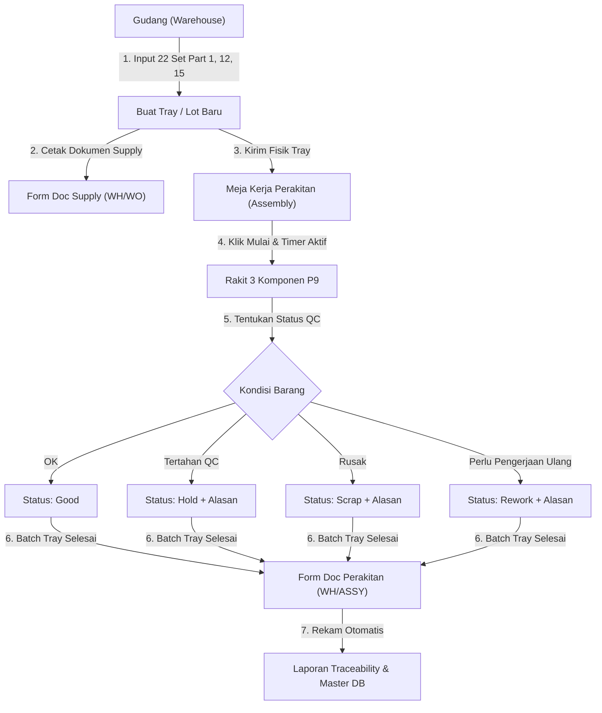

# Sistem Traceability & Manajemen Perakitan Nanggala P9

Aplikasi web terintegrasi untuk pengelolaan rantai suplai gudang, proses kerja stasiun perakitan (*final assembly*), rekam kendali mutu (QC Traceability), serta pencetakan dokumen resmi (*Supply Work Order & Assembly Traveler*).

---

## 📁 Struktur Direktori & Berkas

```text
system SN/
├── app.py                     # Backend HTTP Server & REST API (Python Native + PostgreSQL)
├── schema.sql                 # Definisi Skema Database Relasional PostgreSQL
├── requirements.txt           # Dependensi Python (psycopg2-binary)
├── README.md                  # Dokumentasi Sistem & Petunjuk Penggunaan
├── walkthrough.md             # Catatan Rilis & Fitur Terkini
│
├── static/                    # Berkas Antarmuka Pengguna (Frontend Single Page Application)
│   ├── index.html             # Dashboard Utama (Vue 3, Tailwind CSS, FontAwesome, SheetJS)
│   ├── login.html             # Halaman Autentikasi Pengguna
│   ├── qrcode.min.js          # Generator QR Code Mandiri (Offline)
│   ├── logo-data.js           # Asset Logo NKRI Data URI (Offline Fallback)
│   ├── nkri-logo.png          # Logo Resmi Perusahaan / NKRI
│   ├── nkri-logo.svg          # Logo Versi Vektor SVG
│   ├── nkri-logo-mono.svg     # Logo Vektor Monokrom
│   ├── favicon.png            # Favicon Browser
│   └── emblem.png             # Lambang Logo Aplikasi
│
├── scripts/                   # Utilitas Database & Impor Data
│   ├── check_database.py      # Inspeksi Status Database & Stok Master
│   ├── clear_database.py      # Reset Bersih Data Tray & Perakitan
│   └── import_part15_pdf.py   # Skrip Impor & Ekstraksi Part 15 dari PDF
│
└── tests/                     # Rangkaian Uji Otomatis (Testing Suite)
    ├── test_all_features.py   # Uji Integrasi End-to-End API Alur Lengkap
    ├── test_drilldown.py      # Uji Status Riil Perakitan & Drilldown Modal
    └── validate_html.py       # Validator Keseimbangan Tag HTML & Skrip
```

---

## ⚙️ Persyaratan Sistem & Instalasi

### 1. Prasyarat
- **Python** 3.10+
- **PostgreSQL** 14+
- Browser modern (Google Chrome / Microsoft Edge / Safari)

### 2. Instalasi Driver
```bash
pip install -r requirements.txt
```

### 3. Konfigurasi Database
Pastikan PostgreSQL berjalan dan database `barang_db` telah dibuat:
```bash
# Inisialisasi skema tabel
psql -U postgres -d barang_db -f schema.sql
```

### 4. Menjalankan Server
```bash
python app.py
```
Akses aplikasi melalui browser di `http://127.0.0.1:8000`.

---

## 👥 Hak Akses & Peran Pengguna (*Role-Based Access Control*)

| Role | Akun Bawaan | Akses Tab & Wewenang |
| :--- | :--- | :--- |
| **Administrator** | `admin` / `admin123` | Akses penuh seluruh tab: **Perakitan**, **Gudang**, **Print Document**, **Laporan**, **Master DB**, dan **Kelola User**. |
| **Gudang (Warehouse)** | `gudang` / `gudang123` | Input Supply Tray, Cetak Form Supply (WH/WO), Monitoring Stok Master, dan Laporan. |
| **Assembly (Operator)** | `assembly` / `assembly123` | Meja Kerja Perakitan (*Card Workflow*), Input Hasil Rakit, Status QC (Good/Hold/Scrap/Rework). |

---

## 🔄 Alur Kerja Sistem (*End-to-End Workflow*)



---

## 🖨️ Dokumen Resmi (*Official Printable Documents*)

1. **Form Dokumen Supply (`WH/WO/xxxxxx`)**:
   - Dikeluarkan oleh Gudang saat mensuplai part ke area perakitan.
   - Format tabel bersih tanpa kolom waktu/status pengerjaan (fokus pada jumlah & serial number part yang dikeluarkan).
   - Tanda tangan: **Petugas Gudang Supply** & **Operator Final Assembly**.

2. **Form Dokumen Perakitan (`WH/ASSY/xxxxxx`)**:
   - Dihasilkan setelah perakitan batch selesai.
   - Format tabel lengkap dengan catatan **Waktu Mulai, Waktu Selesai, dan Status QC**.
   - Tanda tangan: **Petugas Gudang**, **Operator Perakitan**, dan **QC Inspector**.

---

## 🧪 Menjalankan Pengujian Otomatis

Jalankan pengujian integritas sistem kapan saja dengan perintah:

```bash
# 1. Jalankan Uji Integrasi End-to-End
python tests/test_all_features.py

# 2. Jalankan Uji Status Riil & Modal Drilldown
python tests/test_drilldown.py

# 3. Jalankan Validasi Struktur HTML
python tests/validate_html.py
```
