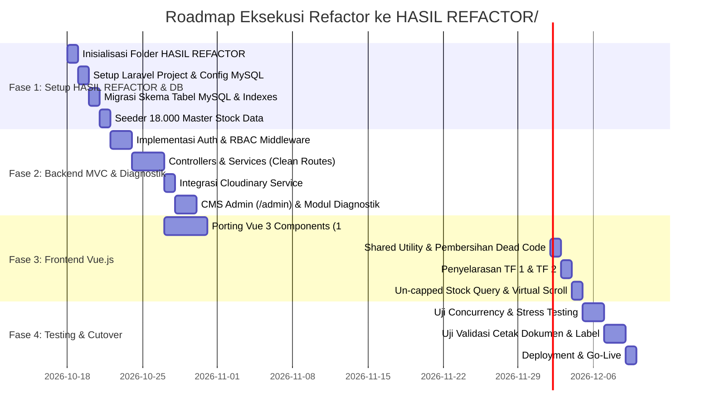

# MASTER PLANNING REFACTOR: SISTEM FINAL ASSEMBLY & TRACEABILITY P9 (FINAL ACUAN UTAMA)

> **Status Dokumen**: **FINAL & TERKUNCI SEBAGAI ACUAN UTAMA EKSEKUSI**  
> **Target Folder Hasil Refactor**: `HASIL REFACTOR/` (di root direktori proyek)  
> **Target Stack**: **Laravel (Backend MVC)** | **Vue.js (Frontend)** | **MySQL 8.0 InnoDB (Database)**  
> **Prinsip Dasar**:
> 1. **Zero Visual Regression**: Tampilan UI/UX 100% sama persis, tidak boleh berubah sedikit pun.
> 2. **High Concurrency & Anti Server Down**: Tidak ada lagi server crash/lag akibat aksi bersamaan.
> 3. **Clean Codebase**: 0% fungsi ganda (*double function*), 0% endpoint bertumpuk (*shadowed API*), 0% kode mati sisa revisi lama.
> 4. **Proactive Diagnostics**: Monitoring realtime error backend, pendeteksi query lambat (penyebab lag), dan pemindai anomali data di CMS `/admin`.
> 5. **Safe Isolation**: Seluruh sistem baru dibangun di dalam folder **`HASIL REFACTOR/`** sehingga sistem lama tetap aman berjalan tanpa gangguan.

---

## 1. Struktur Folder Target: `HASIL REFACTOR/`

Seluruh arsitektur Laravel + Vue.js baru akan ditempatkan secara terisolasi dan mandiri di dalam folder `HASIL REFACTOR/`:

```text
System FA V3/
├── HASIL REFACTOR/                 <-- [FOLDER BARU: Seluruh Sistem Hasil Refactor]
│   ├── app/
│   │   ├── Http/
│   │   │   ├── Controllers/        # Controllers MVC per modul (Warehouse, Assembly, QC, DO, Reports, CMS)
│   │   │   └── Middleware/         # RoleMiddleware, DeveloperAdminMiddleware
│   │   ├── Models/                 # Eloquent Models (User, MasterStock, Tray, Assembly, Part, dll.)
│   │   └── Services/               # TrayService, QcService, CloudinaryService, MaintenanceService, AnomalyService
│   ├── database/
│   │   ├── migrations/             # Skema MySQL lengkap dengan Foreign Keys & Indexing
│   │   └── seeders/                # MasterStockSeeder (18.000 parts), UserSeeder
│   ├── resources/
│   │   ├── js/
│   │   │   ├── components/         # Komponen Vue 3 (WarehouseTab, AssemblyTab, TF1, TF2, PrintDoc, Reports, DO, AdminCMS)
│   │   │   ├── utils/              # Shared Formatters & Helpers (pad, status colors, excel generator)
│   │   │   └── app.js              # Inisialisasi Vue 3
│   │   └── views/
│   │       └── app.blade.php       # Single Page App shell (100% style & asset identik)
│   ├── routes/
│   │   └── api.php                 # REST API bersih tanpa duplikasi route
│   ├── public/                     # Asset grafis, logo NKRI, favicon, qrcode.min.js, html2pdf
│   ├── .env.example                # Konfigurasi MySQL, Cloudinary, Port
│   └── composer.json
│
├── app.py                          <-- [Sistem Lama Python tetap aman berjalan]
├── static/
└── database.db
```

---

## 2. Ringkasan Arsitektur Baru: Solusi Tuntas Server Down

```mermaid
graph TD
    subgraph CLIENT["Frontend (Browser / Tablet / Barcode Scanner)"]
        UI["UI / UX Vue.js (100% Identik & Pixel-Perfect)"]
        OP_PAGE["Halaman Operasional (Gudang, Assembly, TF1, TF2, DO, Laporan)"]
        CMS_PAGE["Halaman CMS Developer (/admin)"]
        UI --> OP_PAGE
        UI --> CMS_PAGE
    end

    subgraph WEBSERVER["Web Server & Concurrency Layer"]
        NGINX["Nginx / Apache / PHP-FPM Multi-Workers"]
    end

    subgraph BACKEND["Backend Laravel MVC (Folder: HASIL REFACTOR)"]
        ROUTER["Laravel Routing & RBAC Middleware"]
        subgraph CONTROLLERS["Controllers Layer"]
            AUTH_C["AuthController"]
            WH_C["WarehouseController"]
            ASY_C["AssemblyController"]
            QC_C["QcController"]
            STK_C["MasterStockController"]
            DO_C["DeliveryOrderController"]
            REP_C["ReportController"]
            ADM_C["AdminCmsController"]
            DIAG_C["DiagnosticController"]
        end
        subgraph SERVICES["Business Logic & Services"]
            TRAY_S["TrayAllocationService"]
            ASSY_S["AssemblyService"]
            QC_S["QcVerificationService"]
            CLOUD_S["CloudinaryService (Upload DO & PL PDF)"]
            MAINT_S["DatabaseMaintenanceService (Pembersihan Tray & Audit)"]
            ANOMALY_S["AnomalyDetectionService (Scanner Data & Lag)"]
        end
        subgraph MODELS["Eloquent Models"]
            M_USER["User"]
            M_STOCK["MasterStock"]
            M_TRAY["Tray"]
            M_PART["Part"]
            M_ASSY["Assembly"]
            M_AUDIT["PartAuditLog"]
            M_DOWNTIME["AssemblyDowntime"]
            M_DO["DeliveryOrder"]
            M_DO_SET["DoSetting"]
            M_ERR["SystemErrorLog"]
        end
    end

    subgraph DATABASE["MySQL 8.0 InnoDB"]
        INNODB["InnoDB Engine: Row-Level Locking + MVCC + Connection Pool"]
    end

    CLIENT -->|REST API Request / Axios| NGINX
    NGINX --> ROUTER
    ROUTER --> CONTROLLERS
    CONTROLLERS --> SERVICES
    SERVICES --> MODELS
    MODELS -->|ACID Transactions| INNODB
```



### Mengapa Sistem Ini Dijamin Bebas Server Down?
* **Penyebab Lama**: Python `ThreadingHTTPServer` + global thread lock `_db_lock = threading.Lock()` + file lock SQLite yang mengunci seluruh database saat ada operasi tulis.
* **Solusi Baru**: 
  - **MySQL InnoDB Engine**: Hanya mengunci baris yang diedit (*Row-Level Locking*), sehingga puluhan operator dapat melakukan scan barcode, input perakitan, dan verifikasi secara simultan tanpa saling mengunci.
  - **Database Transactions (`DB::transaction`)**: Mencegah tabrakan alokasi nomor seri (SN) dan race condition.
  - **PHP-FPM Worker Pool**: Request dieksekusi secara terisolasi; request yang lambat tidak akan membuat antrean hang bagi pengguna lain.

---

## 3. Acuan Final Hasil Audit: Pembersihan Kode Ganda & Kode Mati

Sesuai hasil audit pada codebase lama, kode-kode berikut **dibersihkan dan tidak akan dibawa** ke project `HASIL REFACTOR/`:

### A. Backend [app.py](file:///c:/Users/ibnhu/Desktop/Muhamad%20Ibnhu/Sistem%20Final%20Assembly/System%20FA%20V3/app.py) (Daftar yang Dieliminasi)
1. **Shadowed Route**: `GET /api/delivery-orders/export-data` ganda di baris 4345 & 4494 &rarr; Disatukan ke dalam satu method bersih `DeliveryOrderController::exportData` dengan dukungan pencarian `q`.
2. **Duplicate API Reassembly**: `/api/assemblies/pending-reassembly` (plural/mati) &rarr; Dihapus, hanya menggunakan `/api/assembly/pending-reassembly`.
3. **Duplicate API Serial Number**: `/api/delivery-orders/available-sns` &rarr; Dihapus, disatukan ke `/api/available-serial-numbers`.
4. **Obsolete Sub-Endpoints**: `/api/delivery-orders/next-number` dan `/next-batch` &rarr; Dihapus karena sudah digantikan oleh `/api/delivery-orders/next-meta`.
5. **Dead Endpoint Gudang**: `/api/gudang/history` &rarr; Dihapus karena frontend sudah menggunakan `/assembly/trays` dan `/laporan`.
6. **Dead Route Eksperimen**: `/api/assembly/clear-in-progress` (tabel lama `assembly_in_progress`) &rarr; Dihapus total.
7. **Unused Verification Route**: `/api/admin/pending-verifications-all` &rarr; Dihapus, hanya menggunakan `/admin/pending-verifications`.
8. **Unused CRUD**: `/api/customers/update`, `/customers/delete`, `/cloud-pdf/delete` &rarr; Dihapus.

### B. Frontend [static/index.html](file:///c:/Users/ibnhu/Desktop/Muhamad%20Ibnhu/Sistem%20Final%20Assembly/System%20FA%20V3/static/index.html) (Daftar yang Dieliminasi)
1. **Fungsi Duplikat**: `getStatusColorConfig()` (2x), `scanCrates()`/`scanBoxes()` (2x), `cleanup()` (2x), dan `pad()` (7x) &rarr; Disatukan ke dalam satu modul helper bersama (`resources/js/utils/formatters.js`).
2. **Sisa Kode Printer Zebra ZPL**: `copyZPLCode()` dan `printP9LabelDirect()` &rarr; Dihapus total dari JavaScript.
3. **Sisa Eksperimen HTML String**: `buildPackingListHTMLString()` (~140 baris kode string) &rarr; Dihapus total.
4. **Ekspor Excel Lama**: `exportToExcel()` & `exportTrayToExcel()` &rarr; Dihapus total, digantikan oleh `exportCurrentReportToExcel()`.
5. **76 Dead Functions**: Seluruh fungsi di `setup()` yang tidak lagi memiliki tombol/elemen di HTML &rarr; Dieliminasi dari bundle.

---

## 4. Penyelarasan Revisi Logika Aktual & PDF

### A. Tampilan Stok Master Tanpa Batasan (Poin 2)
- **Aturan Baku**: Menghapus seluruh batasan query (`limit=1500` dan `limit=5000`). Seluruh data stok (hingga 18.000+ nomor seri P1, P12, P15) harus bisa ditampilkan secara utuh kapan pun diminta.
- **Implementasi Teknis**:
  - Penambahan **Composite Index** MySQL: `CREATE INDEX idx_master_type_status_tray ON master_stocks(part_type, status, allocated_tray_id);`
  - Frontend Vue menerapkan *virtual scrolling / progressive chunk rendering* agar tabel stok render instan di browser tanpa membuat memori RAM komputer lambat.

### B. Functional Test 1 (TF 1) vs Functional Test 2 (TF 2 / QC)
- **Aturan Baku**:
  - **TF 1 (Tes Fungsional 1 - Assembly)**: Menjalankan **17 parameter checklist pengujian** langkah-demi-langkah.
  - **TF 2 (Tes Fungsional 2 - QC)**: **TIDAK ADA 17 PENGUJIAN**. QC hanya menampilkan rekap hasil checklist dari TF 1 secara Read-Only, lalu memilih **Good (Lolos)** atau **Not Good (Hold)** dalam **satu kali klik**.
- **Implementasi Teknis**: Logika ini dikunci pada `QcVerificationService` di backend dan `QcTestingTab.vue` di frontend.

---

## 5. Perancangan Halaman Admin CMS (`/admin`)

Halaman khusus developer/super-admin dengan hak akses penuh terhadap konfigurasi sistem, pemeliharaan basis data, dan **diagnostik realtime**:

```
+-----------------------------------------------------------------------------------+
| CMS DEVELOPER & SYSTEM CONTROL PANEL (/admin)                                     |
+-----------------------------------------------------------------------------------+
| [1. Pembersihan Tray]  [2. Pembersihan Audit]  [3. Pengaturan DO]  [4. Diagnostik]|
+-----------------------------------------------------------------------------------+
| FITUR 1: Pembersihan Database Seluruh Tray                                        |
| -> Reset tabel: trays, parts, assemblies (Truncate aman cascade).                |
| -> Kembalikan 18.000 master_stocks ke status 'Tersedia' secara otomatis.          |
|                                                                                   |
| FITUR 2: Pembersihan Audit Downtime & Total                                       |
| -> Hapus seluruh log assembly_downtimes (jeda operator).                          |
| -> Hapus log histori part_audit_logs & assembly_wo_history.                       |
|                                                                                   |
| FITUR 3: Pengaturan Default Delivery Order (Pindahan dari tab DO operasional)     |
| -> Form edit: Nama PT, Alamat Pabrik/Kantor, Email, Default Customer (Kemhan),   |
|    Prefix (/SJ/PPIC/, /PL/PPIC/), Kapasitas Crate (20), Box (10), Offset Bulan,   |
|    dan Kredensial API Cloudinary (API Key, Secret, Cloud Name).                   |
|                                                                                   |
| FITUR 4: Diagnostik Backend (Error Logger, Anomaly Scanner, & Lag Monitor)        |
| -> Error Logger: Log realtime error 500, file error, line number, user & waktu.  |
| -> Slow Query & Lag Monitor: Menampilkan API/Query yang berjalan > 500ms/1000ms.   |
| -> Anomaly Scanner: Pengecekan orphan parts, stuck session > 8 jam, desinkronisasi|
|    stok master vs tray, dilengkapi tombol [1-Click Auto Repair].                  |
+-----------------------------------------------------------------------------------+
```

---

## 6. Keputusan Status Fitur & Codebase

1. **Cloudinary (TETAP DIGUNAKAN)**: Terintegrasi via `CloudinaryService` untuk sinkronisasi cloud dokumen DO & Packing List.
2. **File Backup & Scratch Lama (DITINGGALKAN)**: File `database.db.backup_...` dan file scratch python tidak dimasukkan ke dalam folder `HASIL REFACTOR/`.
3. **Skrip Manual Darurat (DIGANTIKAN SEEDER RESMI)**: `update_database_pc.py` dan `tambah_data_manual_p12.py` digantikan oleh `MasterStockSeeder` di Laravel.

---

## 7. Jaminan Preservasi UI/UX 100% Identik (Zero Visual Regression)

Setiap elemen visual yang dilihat oleh operator dan manajemen tetap **sama persis tanpa perubahan sekecil apa pun**:
- **Palette Warna**: Merah `#dc2626`, Emerald `#059669`, Amber `#d97706`, Slate `#0f172a`.
- **Tipografi**: Mengunci font **Roboto** di seluruh elemen dan tabular-nums untuk angka serial number.
- **Format Cetak Dokumen Resmi**:
  1. Form Dokumen Supply Gudang (`WH/WO/xxxxxx`)
  2. Dokumen Traveler Perakitan (`WH/ASSY/xxxxxx`)
  3. Dokumen Uji Fungsional 1 (`assy_qc`)
  4. Dokumen Uji Fungsional 2 / Mutu QC (`wh_qc`)
  5. Surat Jalan DO & Packing List (A4 / A5 Landscape)
  6. Label Kemasan Crate, Box & Label Satuan Unit (Thermal 80x20mm)

---

## 8. Tahapan Eksekusi Bertahap (Roadmap)


